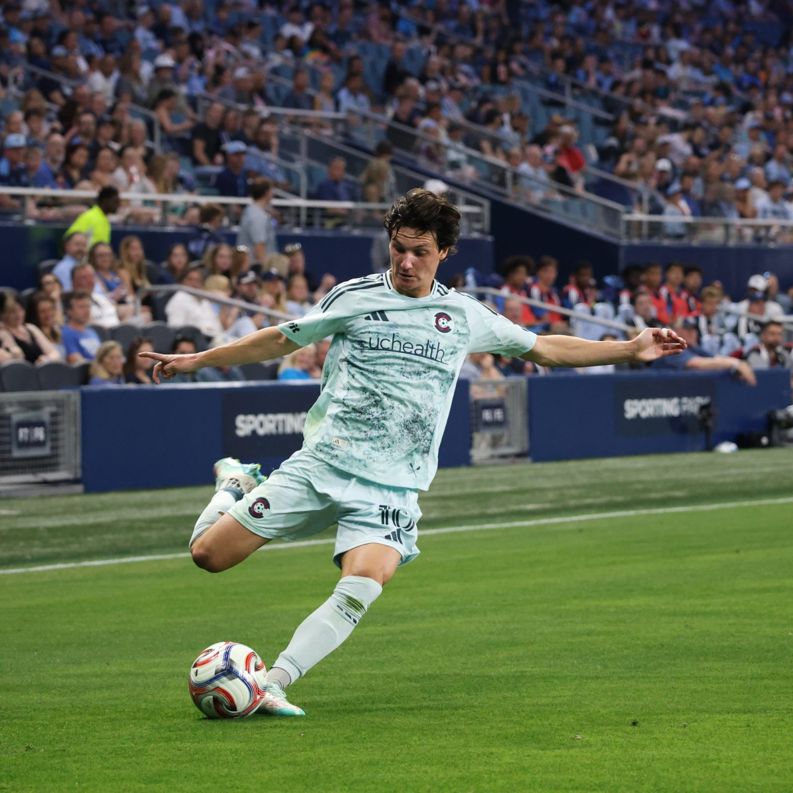
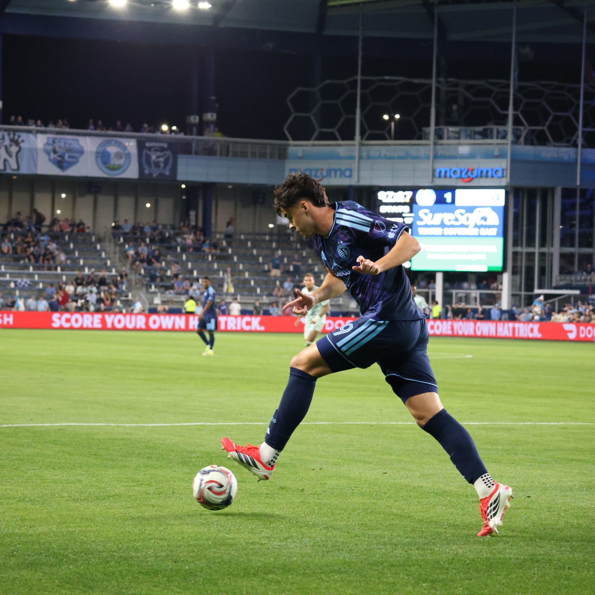

Colorado Rapids made a statement with their away performance as they thrashed Sporting Kansas City 4-1 in an exciting encounter in Major League Soccer.

The visitors did not wait long to assert their dominance over their opponents. Paxten Aaronson scored in the 12th minute to give Colorado an early lead.

However, their opponents responded with a goal from Magomed Suleymanov in the 44th minute to level the scores and spark their home crowd.

The visitors were quick to pick up their rhythm and went on to score their second goal in first-half stoppage time through Wayne Frederick to retake the lead.

The second half belonged to Colorado Rapids. Rafael Navarro scored in the 71st minute to increase their lead and put pressure on their opponents. Just two minutes after that, Aaronson sealed his impressive display with a second goal in the 75th minute to seal a comprehensive victory for his side.

The attacking prowess and efficiency of Colorado Rapids proved to be too much for their opponents, Sporting Kansas City.

photos by Nash Ferg
