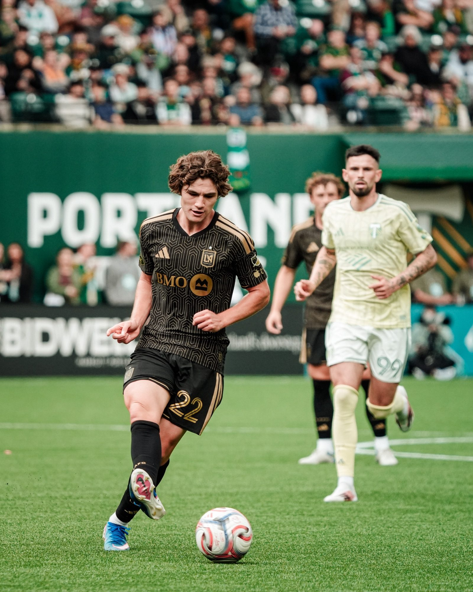

The Portland Timbers defeated LAFC 2-1 at Providence Park, securing the win with a late goal in a closely contested match.

Kristoffer Velde gave the Timbers the lead in the 32nd minute, finishing a quick breakaway.

Jude Terry equalized for LAFC in the 49th minute, shortly after coming on in the second half.

The second halThe second half was competitive, with both teams seeking a decisive goal. LAFC pressed forward but were consistently denied by Portland’s defense. In the final moments, the Timbers secured the breakthrough. minute, Kevin Kelsy pounced to nudge the ball over the line, sealing a thrilling 2-1 triumph for the Timbers as the clock ran out.

This unforgettable victory shattered LAFC’s flawless start to the MLS season and brought their unbeaten run to an abrupt end.

Scoresheet

Portland Timbers: Kristoffer Velde (32’), Kevin Kelsy (90+6’) 
LAFC: Jude Terry (49’)

*The 17-year-old scored his first MLS goal by scoring an equalizer in his debut game for the club. He did this through a precise first-time strike from a cut-back.*

Photos by Jeffrey Diaz
