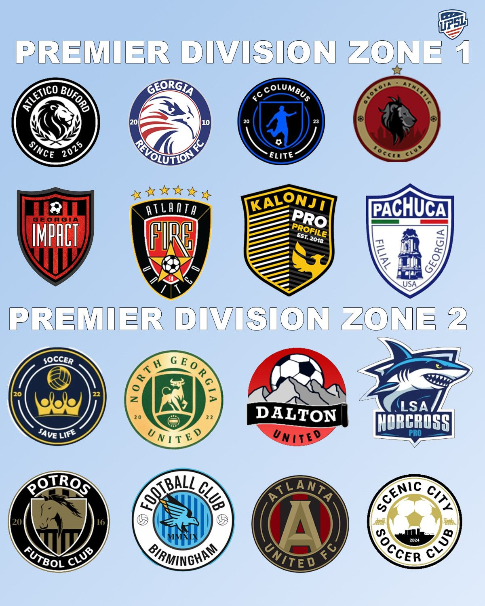

The UPSL Georgia Conference (Premier Division) is set for major growth in the Fall 2025 season, expanding from 14 to 16 clubs. The upcoming campaign will also mark the highly anticipated return of Atlanta United Academy to the competition. 
The conference will be organized into two zones of eight teams. At the conclusion of the regular season, the top four teams from each zone will qualify for the conference playoffs, while the bottom team in each zone will be relegated to Georgia Division 1. The conference playoff champion will earn a spot in the first round of the UPSL National Playoffs. The Fall 2025 schedule will be announced soon. Each club will face all opponents within its zone once, and will also compete in home-and-away fixtures against designated sub-group opponents, totaling 10 regular season matches.
