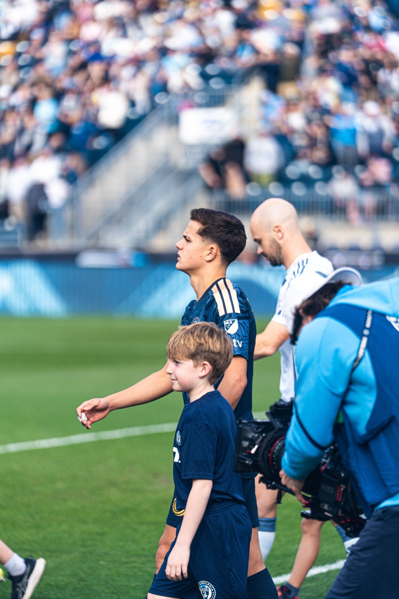

In a historic night at Subaru Park, Cavan Sullivan made his first start in Major League Soccer, and Malik Jakupovic made his MLS debut, but the night was marred by a 1-2 loss to the Chicago Fire FC.

Chicago opened the scoring through Hugo Cuypers, and the early goal gave the Fire the lead and quieted the home crowd.

Philly came out strong, having possession for periods of the match. Sullivan was fearless in his first start, and the debut of Jakupovic provided the team with a look at their young talent. The hard work paid off, however, as Milan Iloski scored the equalizing goal, bringing the match to level for the Union.

However, Chicago would deliver the final blow. In the latter part of the match, Jonathan Bamba scored the winner on the break, putting the Fire ahead once again. The Union would not be able to find the equalizing goal.

Final score: Philadelphia Union 1, Chicago Fire FC 2

A night filled with milestones for the young talent in Philly, but the match would be decided by moments that saw all three points awarded to Chicago.

photos by Tolu Oliwo
