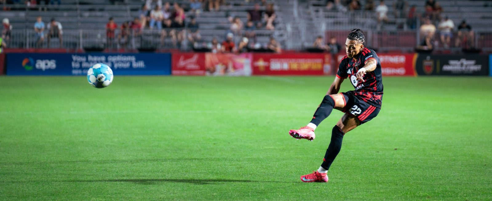

In a thrilling USL Championship match, Phoenix Rising FC and Oakland Roots SC fought out a 2-2 draw on March 22, 2026, at the Phoenix Rising Stadium.

Oakland Roots SC started the match on a high note and surprised the home fans with two first-half strikes. Forward Wolfgang Prentice opened his account with a well-worked goal in the 42nd minute, which gave his side a 1-0 lead over their rivals. A minute before halftime, Oakland’s defender Julian Bravo made it 2-0 with a strike, putting his side firmly in command with a 2-0 lead going into the break. 

Phoenix Rising SC had a tough start but showed great resilience in the second half. A late strike by midfielder Diego Gómez in the 85th minute gave them hope of getting back into the match and making a comeback. With this momentum, the home side attacked relentlessly in the stoppage minutes. 

The relentless attack by the home side bore fruit in the 90+6’ minute when Gunnar Studenhofft’s strike earned his side an equalizer, sending the home fans into jubilation. 

Despite Oakland’s dominance in the first half, the late equalizer by the home side ensured both teams earned a point apiece from the match.

photos by José Pérez
