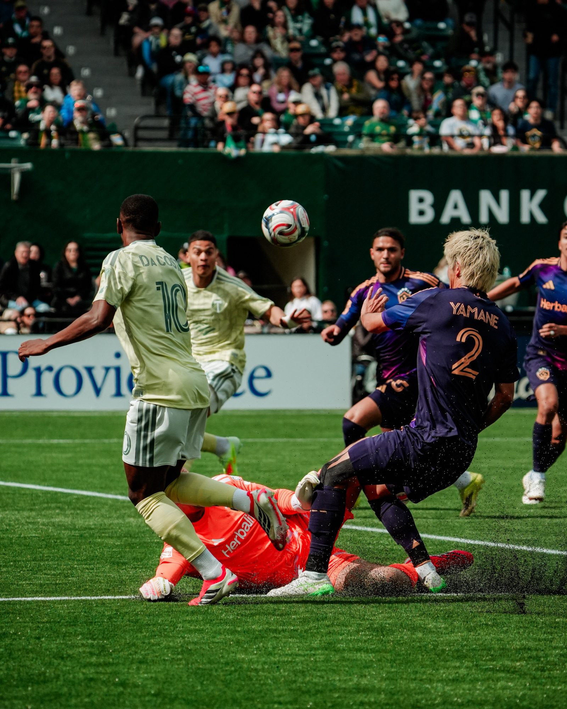

In a match that was all about grit and early drama, the Portland Timbers drew 1-1 with the LA Galaxy on Sunday night, despite being reduced to 10 men after a red card in the first half.

The Timbers did not take long to put their mark on the match at home, as winger Kristoffer Velde found the back of the net in the 13th minute of the match. Velde, a Norwegian international, showed a lot of composure at the end of a beautiful move to score, sending the Providence Park crowd into a frenzy.

However, the match was not without drama, as Portland defender Kamal Miller was given a red card in the 17th minute for a last-man foul, leaving them to play over 70 minutes with a man down.

Taking their cue from this perceived opportunity, the Galaxy acted fast to level matters in the 30th minute, with their striker, João Klauss, scoring from a pass by their experienced playmaker, Marco Reus.

Despite being a man down, Portland demonstrated incredible defensive discipline in the second half of the game. They managed to withstand an onslaught of Galaxy attacks, with their defensive organization and timely interventions denying them a crucial goal while they remained a man down.

Los Angeles was pressing hard to get a winner, but Portland’s determination was their undoing in this game. They remained solid and looked to catch their opponents off the counter, but they were unable to score in this game.

The game was a win for Portland, given their determination in adversity, while Los Angeles might see this game as a lost opportunity, given that they had a man advantage for most of this game.

Both teams go out with a point, but the story of the night was the grit displayed by the Timbers to turn a potentially disastrous situation into a performance that could define their early-season identity.
