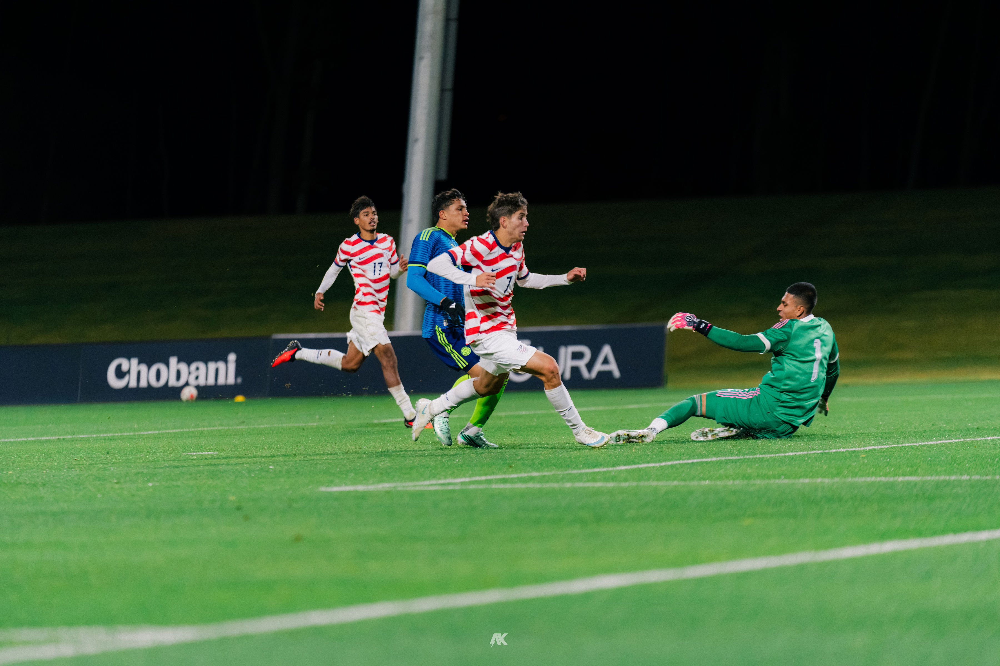
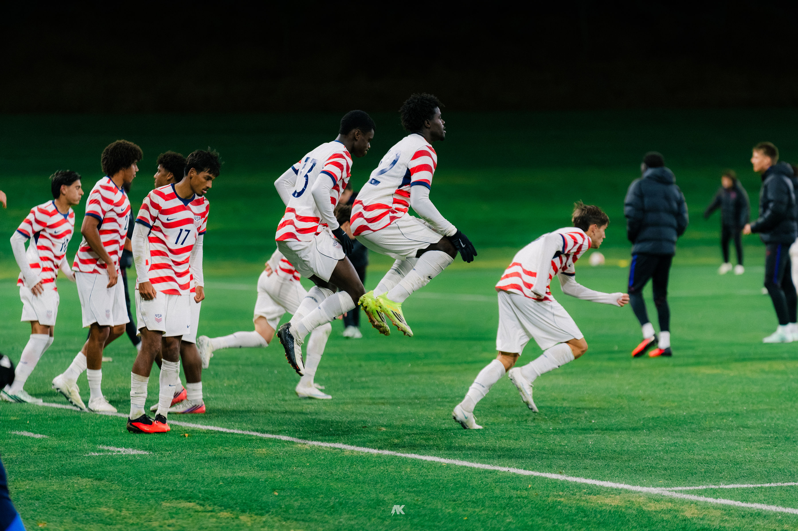
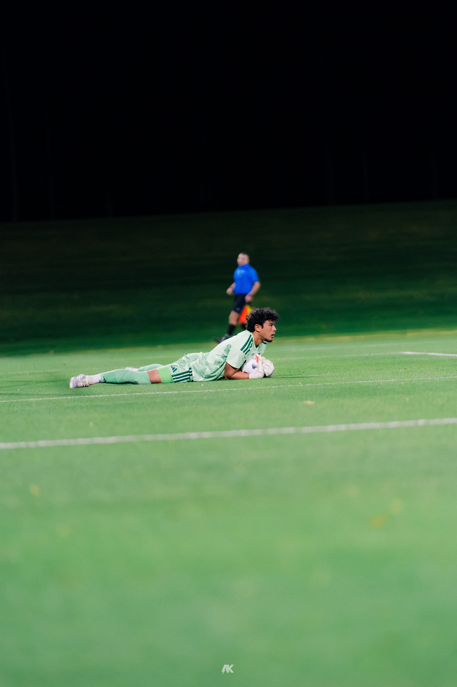
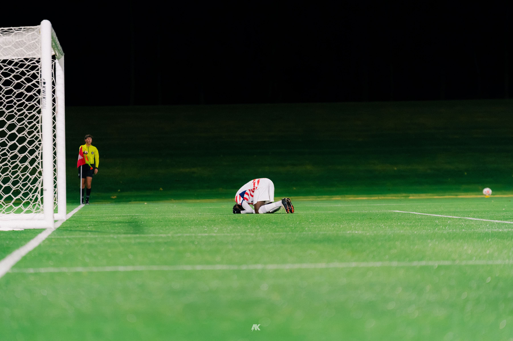
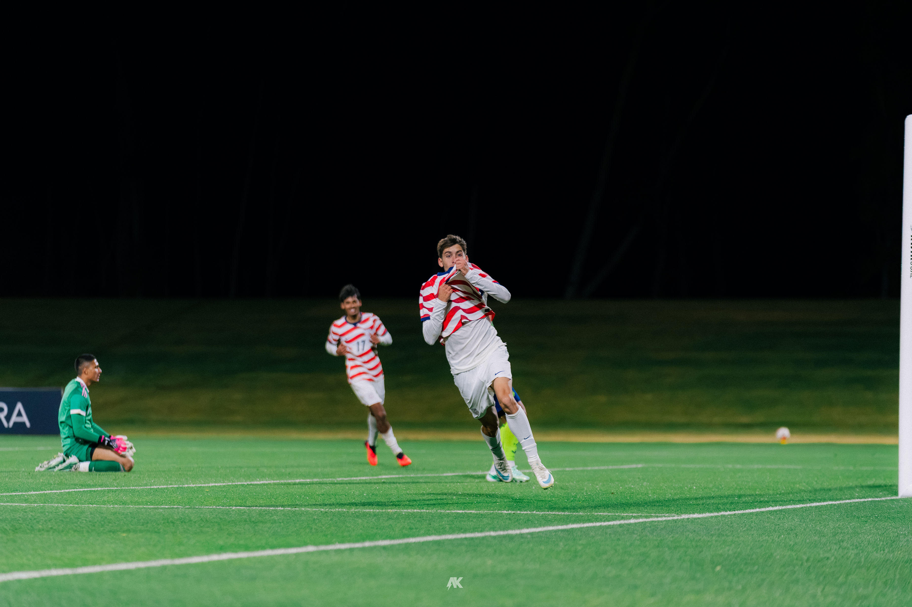
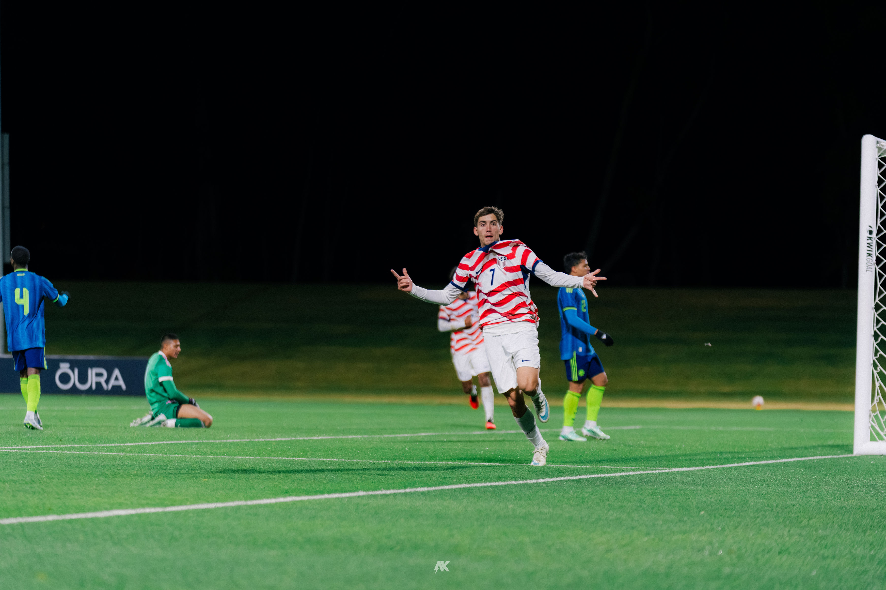
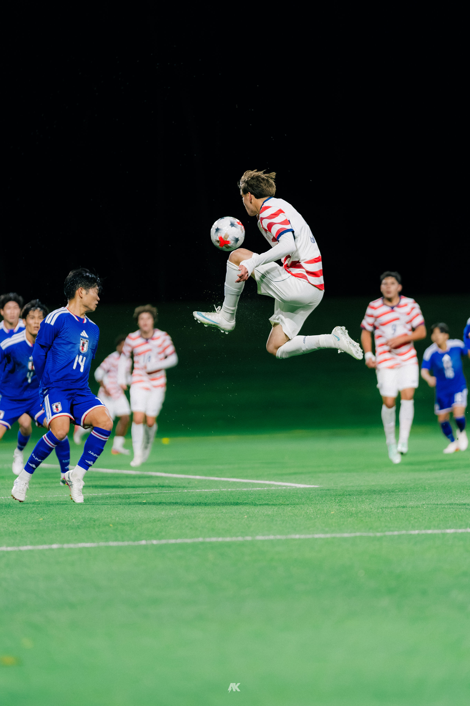
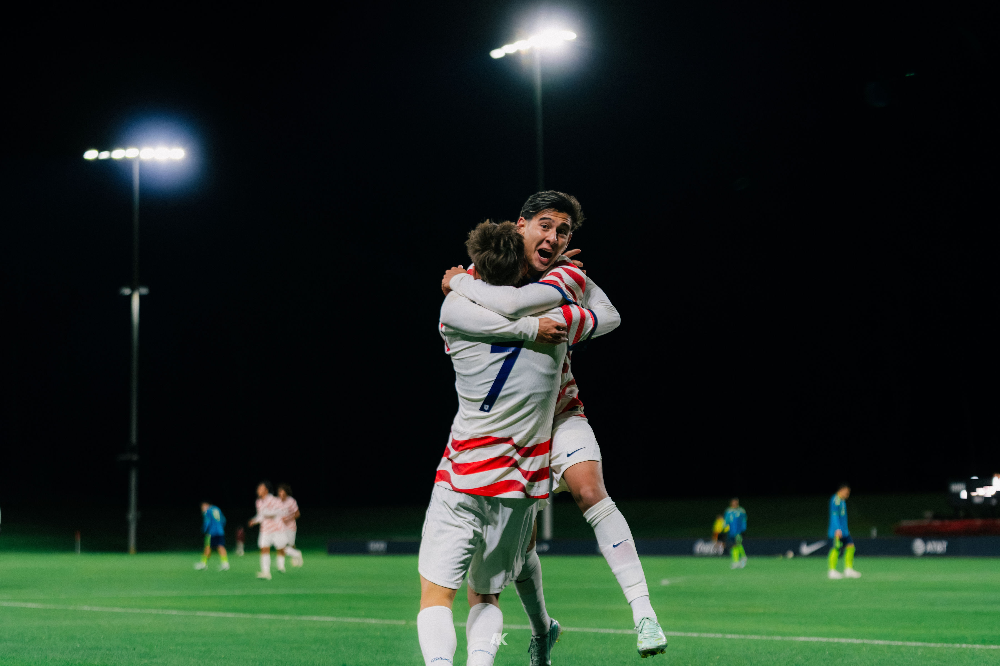
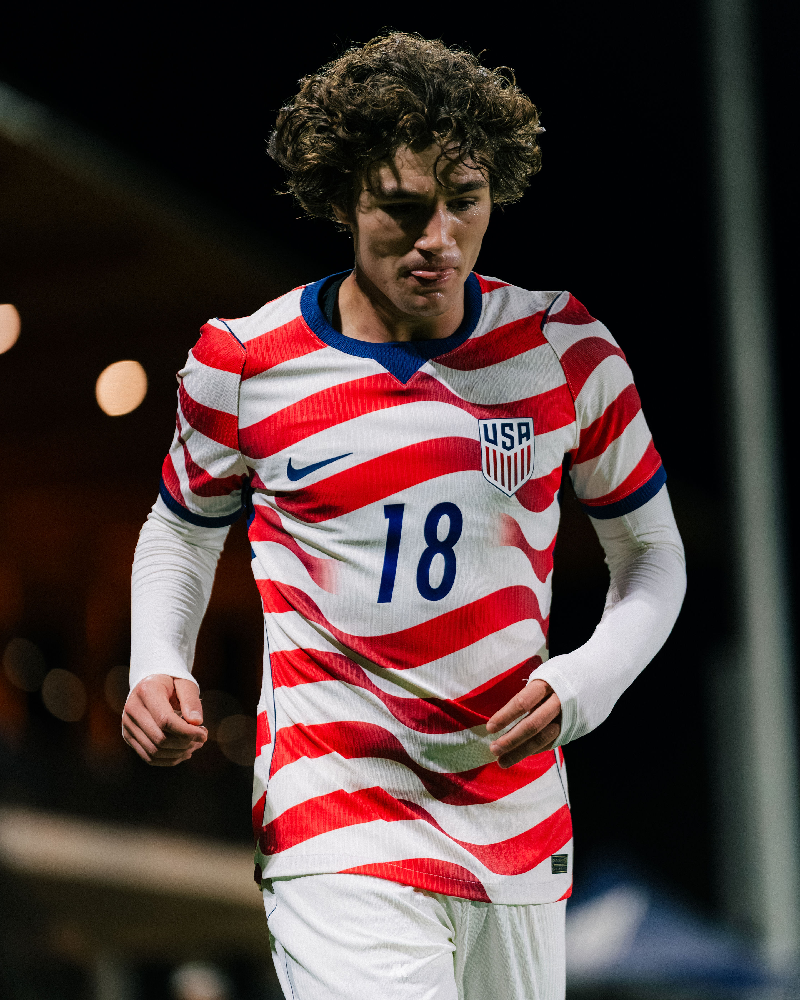
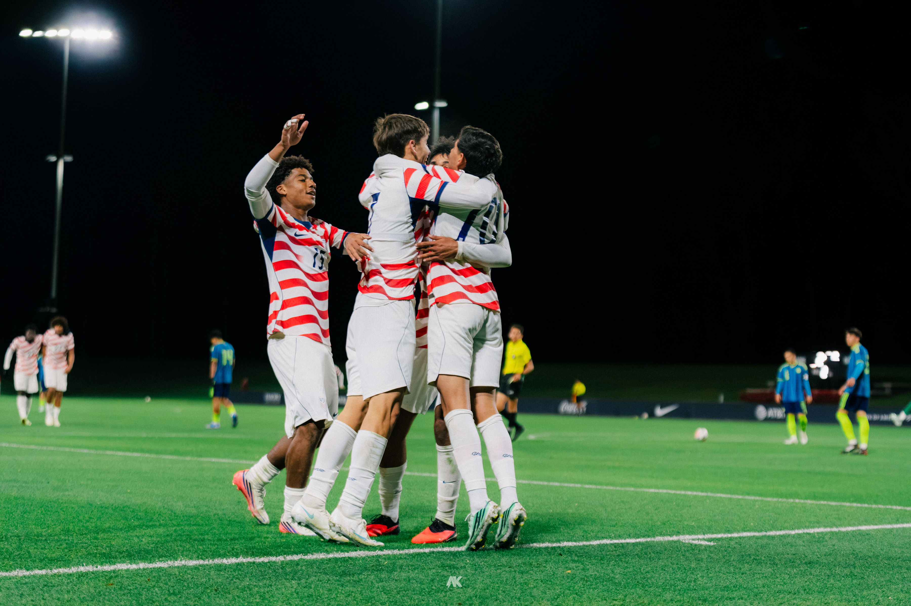

The U.S. U-20s just wrapped nine days at the National Training Center in Fayetteville, and if you only look at the record — one win, two losses — you'd miss the real story. This camp was a checkpoint on the road to the U-20 World Cup next September in Azerbaijan and Uzbekistan, and head coach Gonzalo Segares got exactly what he needed: three very different tests, and a clear picture of where this group stands.

The roster tells you where American soccer is right now. Fourteen of the 24 play in MLS, nine are in Europe — Frankfurt, Leipzig, Bremen — and there's Liga MX in the mix too. In goal, Giorgio De Marzi of Roma and Kayne Rizvanovich of Minnesota United. LA Galaxy defender Harbor Miller and Sporting Kansas City forward Ruben Ramos Jr. are names you'll keep hearing.

## Japan 2, USA 0 — Nov. 12

The opener was a wake-up call. Japan came out, set the tone under the lights, and the U.S. never really got going. 2-0. That's the kind of result that changes the whole week — suddenly every session matters more, and every selection decision carries weight.

## USA 3, Colombia 0 — Nov. 14

Saturday night was the one. Three goals, a clean sheet, and the most complete performance of the camp. Santiago Morales scored twice and set up another, and his Inter Miami teammate Daniel Pinter added the third. For me, this is the version of this team that can do something next September — the goals against Colombia showed the ceiling.

## Paraguay 2, USA 1 — Nov. 17

The closer was a lesson. Paraguay led 1-0 at halftime, Pinter pulled one back in the 64th — his second goal of the tournament — and then Ezequiel Duarte won it in the 78th. 2-1. A tough way to end the week, but an honest one.

## What comes next

The 1-2 record stings, but remember where this group started the year — they won all three group games at the Concacaf U-20 Championship (3-0 Haiti, 3-0 El Salvador, 5-0 Cuba) before falling 2-0 to Mexico in the final at Azteca Stadium. Fayetteville wasn't a final exam. It was a checkpoint. Segares got nine days, three games, and a real read on his team. The Colombia game showed what this group can be. The other two nights showed the work that's left.

All photos: Andrew Khai Filmz.